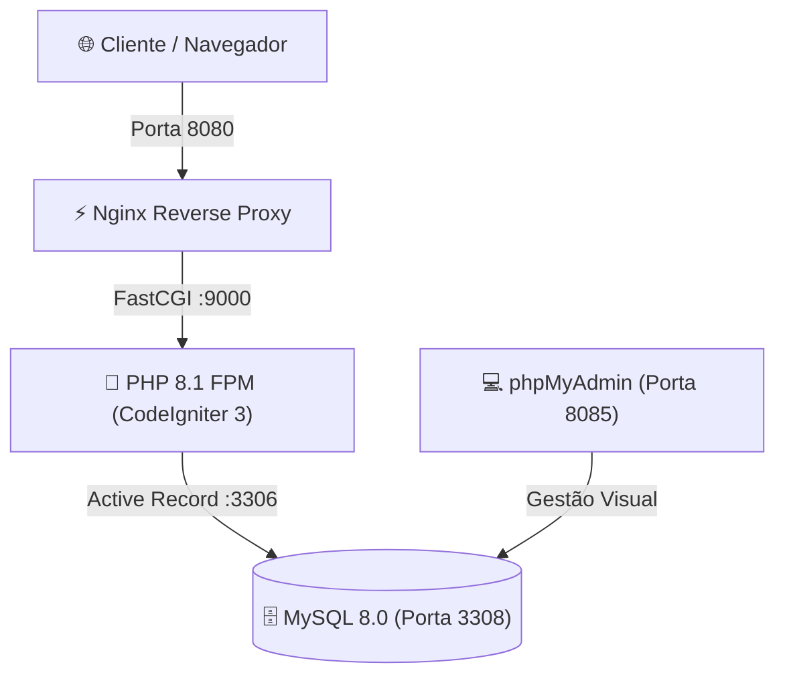

<div align="center">

# 💎 Fragance Euphoria — E-commerce & Painel Administrativo

<p align="center">
  
</p>

[](https://www.php.net/)
[](https://codeigniter.com/)
[](https://www.mysql.com/)
[](https://nginx.org/)
[](https://www.docker.com/)
[](#)

<cite>Plataforma completa de comércio eletrônico para perfumaria fina com vitrine pública, checkout com baixa de estoque, gestão de pedidos e painel de controle administrativo em CodeIgniter 3 e Docker.</cite>

</div>

---

## 📌 Visão Geral

O **Fragance Euphoria** é uma aplicação completa de e-commerce desenvolvida em CodeIgniter 3 voltada para o mercado de fragrâncias e perfumaria importada e nacional. O projeto conta com duas frentes integradas: a **Loja Virtual Pública** (vitrine, categorias, promoções, carrinho interativo e checkout) e o **Painel de Controle Administrativo** (gestão de catálogo, marcas, clientes, pedidos e dashboard financeiro em tempo real).

---

## 🏛️ Arquitetura da Solução



---

## ✨ Funcionalidades Principais

### 🛍️ Loja Virtual (Vitrine Pública)
- **Catálogo Dinâmico:** Listagem com filtros por gênero (*Masculino*, *Feminino*, *Unissex*) e marcas.
- **Página de Detalhes:** Ficha técnica olfativa, notas aromáticas, volume em ml e fotos dos frascos.
- **Carrinho Interativo:** Adição de múltiplos produtos, alteração de quantidades, exclusão e cálculo dinâmico de frete.
- **Fluxo de Checkout Completo (Novo):** Formulário de endereço de entrega, opções de pagamento (*PIX*, *Cartão de Crédito* ou *Boleto*), criação de pedido no banco, baixa automática no estoque e tela de recibo de compra.

### 🛡️ Painel Administrativo (Backoffice)
- **Dashboard com Métricas em Tempo Real:** Faturamento acumulado (R$), total de pedidos, perfumes cadastrados e alertas de estoque crítico (&le; 10 unidades).
- **Módulo de Gestão de Pedidos (Novo):** Visualização completa do histórico de compras, detalhes dos itens adquiridos e formulário para alteração de status (*Pendente*, *Pago*, *Enviado*, *Entregue*, *Cancelado*).
- **Gestão de Perfumes & Marcas:** Cadastro, edição, exclusão e upload de fotos.
- **Autenticação RBAC com Login em 1 Clique:** Três perfis de teste pré-configurados.

---

## 👥 Perfis de Acesso & Demonstração (1 Clique)

A tela de login do painel administrativo conta com atalhos de autenticação instantânea:

| Perfil | E-mail | Senha | Permissões |
|---|---|---|---|
| **Administrador** | `admin@fragance.com` | `Password@123` | Acesso total: métricas financeiras, catálogo, clientes e pedidos |
| **Gerente de Vendas** | `gerente@fragance.com` | `Password@123` | Gestão de perfumes, controle de estoque e atualização de status de pedidos |
| **Atendente de Loja** | `atendente@fragance.com` | `Password@123` | Consulta ao catálogo de produtos e visualização de pedidos |

---

## 🛠️ Tecnologias Utilizadas

- **Linguagem:** PHP 8.1 FPM
- **Framework:** CodeIgniter 3.1.13
- **Banco de Dados:** MySQL 8.0 com charset `utf8mb4`
- **Servidor Web:** Nginx 1.25 Alpine
- **Conteinerização:** Docker & Docker Compose v2
- **Frontend:** Bootstrap 4 & 5, FontAwesome 6, jQuery, Google Fonts (*Playfair Display* e *Plus Jakarta Sans*)

---

## 🚀 Como Executar

### 1. Clonar o Repositório
```bash
git clone https://github.com/omartins-zs/Fragance_Euphoria.git
cd Fragance_Euphoria
```

### 2. Execução com Docker (Recomendado)
```bash
# Configurar variáveis de ambiente
cp .env.example .env

# Subir a stack completa
docker compose up -d --build
```
- Acesse a Loja Virtual: [http://localhost:8080](http://localhost:8080)
- Acesse o Painel Admin: [http://localhost:8080/admin/login](http://localhost:8080/admin/login)

### 3. Execução Local (Host)
Consulte as instruções detalhadas em [`docs/COMO_EXECUTAR_LOCAL.md`](file:///C:/Projetos/Fragance_Euphoria/docs/COMO_EXECUTAR_LOCAL.md).

---

## 📚 Documentação Complementar

- [Acessos, Credenciais e Testes](file:///C:/Projetos/Fragance_Euphoria/docs/ACESSOS_TESTES.md)
- [Como Executar - Visão Geral](file:///C:/Projetos/Fragance_Euphoria/docs/COMO_EXECUTAR.md)
- [Como Executar Localmente](file:///C:/Projetos/Fragance_Euphoria/docs/COMO_EXECUTAR_LOCAL.md)
- [Como Executar com Docker Compose](file:///C:/Projetos/Fragance_Euphoria/docs/COMO_EXECUTAR_DOCKER.md)

---

<div align="center">

Feito com ❤️ por **[Gabriel Martins](https://github.com/omartins-zs)** 🚀

</div>
